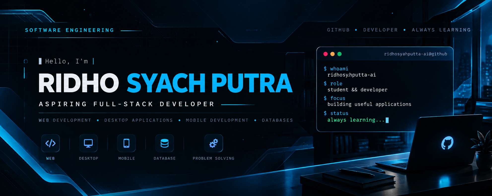

# Ridho Syach Putra

**Software Engineering Student · Aspiring Full-Stack Developer**

Building software, learning new technologies, and improving through projects.

---

## About Me

Software Engineering student from Bandung, Indonesia.

Interested in full-stack development, application design, and database systems.

Currently exploring Laravel, UI/UX, and software architecture.

## Tech Stack

**Languages**

PHP · C# · JavaScript · Java · Kotlin · C++ · HTML · CSS

**Frameworks & Tools**

Laravel · Bootstrap · WinForms · MySQL · MariaDB · Git · GitHub

---

## Featured Projects

| Project | Description |
|---|---|
| [Bibliotech](https://github.com/ridhosyahputta-ai/bibliotech) | Library management system built with PHP and MySQL. |
| [Laravel POS System](https://github.com/ridhosyahputta-ai/laravel-pos-system) | Point-of-sale application built with Laravel and MariaDB. |

---

## Let's Connect

  
  

<!-- Email and Instagram will be added later -->

