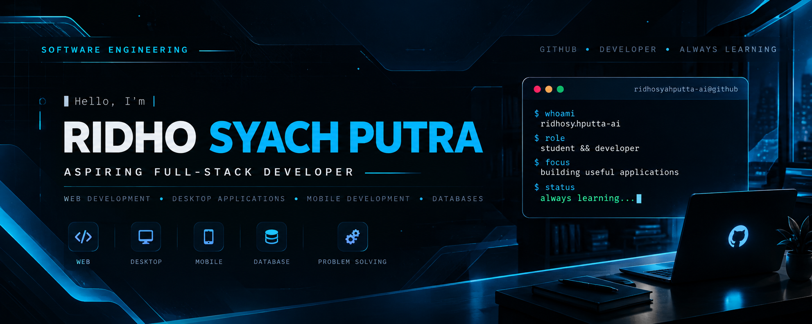

# Hi, I'm Ridho! 👋

### Aspiring Full-Stack Developer · Software Engineering Student

---

## 👨‍💻 About Me

Hi! I'm **Ridho Syach Putra**, a Software Engineering student from Indonesia with a passion for full-stack development.

I enjoy building web applications, desktop systems, and database-driven solutions. I'm continuously learning and improving through practical projects.

- 📍 Based in **Indonesia**
- 🎓 **Software Engineering Student**
- 🎯 Focused on **Full-Stack Development**
- 🛠️ Building practical projects and improving my skills

## 🧰 Languages & Tools

**Programming & Web Languages**

**Frameworks & Technologies**

**Databases & Development Tools**

## 📂 Featured Projects

| Project | Description | Status |
| :--- | :--- | :--- |
| [Bibliotech](https://github.com/ridhosyahputta-ai/bibliotech) | Library management system built with native PHP and MySQL. | In Development |
| [Laravel POS System](https://github.com/ridhosyahputta-ai/laravel-pos-system) | Point-of-sale system built with Laravel and MariaDB. | In Development |

> Both projects are currently in development. Live demos may not be available yet.

## 📊 GitHub Activity

  
  

Statistics are generated by third-party services and may occasionally be unavailable.

## 🤝 Let's Connect

<!-- Add your verified LinkedIn and portfolio URLs here when ready. -->

---

  Building · Learning · Improving

